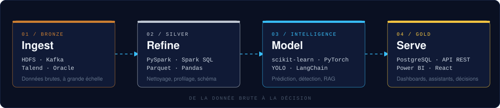

 

 

 

## How I build

 

## Experience

| Year | Role | Company |
|:--|:--|:--|
| 2026 | Data Analytics & Machine Learning Intern | Capgemini TS |
| 2025 | AI & Web Development Intern | NEXTRONIC |
| 2025 – now | Project Lead | APPINSCIENCES, university tech club |

 

## Selected work

| Project | Domain | Core stack |
|:--|:--|:--|
| **TaxiFlow** | Big Data pipeline | `PySpark` `HDFS` `PostgreSQL` `Power BI` |
| [**Chat-With-PDFs**](https://github.com/Zakaria-reb/Chat-With-PDFs) | Multimodal RAG | `LangChain` `ChromaDB` |
| **ADAS** | Computer Vision | `YOLO` `PyTorch` `OpenCV` |
| **Health Insurance BI** | Data Warehousing & BI | `Talend` `Oracle` `Looker Studio` |
| [**ChatIA**](https://github.com/Zakaria-reb/ChatIA) | Conversational AI | `LangChain` `React` `Node.js` |
| [**KafkaACL-Visualizer**](https://github.com/Zakaria-reb/KafkaACL-Visualizer) | Developer tooling | `Kafka` `JavaScript` |

Some repositories are private. Happy to walk through them in an interview.

 

## Stack

 

 

 

 

## Education

**ENSA El Jadida**, Engineering Degree in Computer Science & Emerging Technologies, 2024 – 2027

AWS Academy Graduate (Cloud & Data Engineering, Machine Learning for NLP) · Oracle Certified Professional, Java SE 17 · IBM, SQL for Querying Databases

 

## Activity

 

## Let's talk

I am looking for a **6-month PFE internship starting January 2027** in Data Engineering, Machine Learning and Generative AI. If you have a problem where data has to become a decision or a product, I would like to hear about it.

